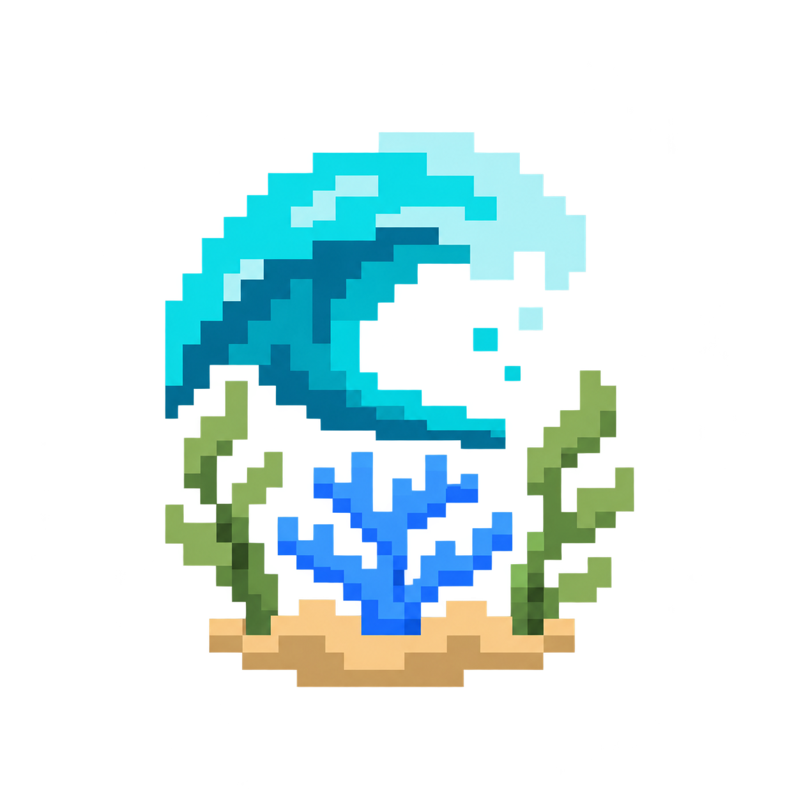
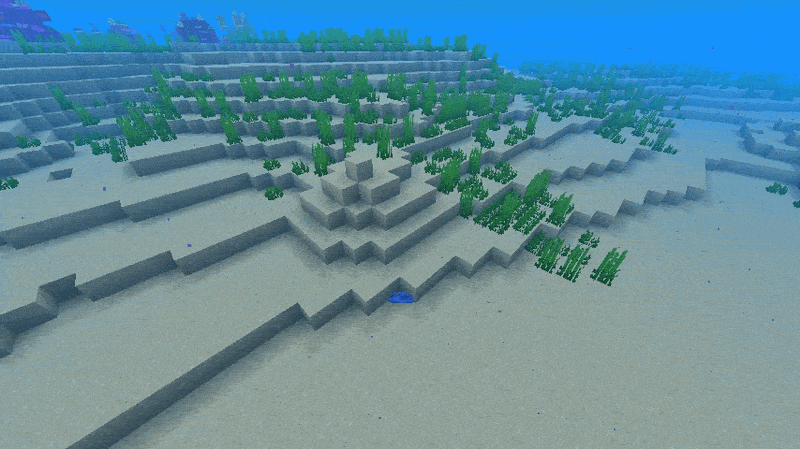

<h1 align="center">$\LARGE\color{blue}{\textsf{Living Oceans}}$

  

</h1>

<b>Living Oceans</b> - Living corals, seagrass and kelp that spread naturally and form thriving vanilla oceans.

---

  

---
## $\large\color{blue}{\textsf{How It Works}}$

- Corals, seagrass and kelp spread from healthy nearby sources while the area is loaded.
- Descendants keep their original colony centre; density and radius limits prevent endless expansion.
- Mature coral habitats build reefs one block at a time using vanilla-generated shapes.
- New seagrass can be short or tall, and natural kelp receives varied height limits.

---

## $\large\color{blue}{\textsf{Requirements}}$

- Minecraft Java Edition 26.3 and Java 25.
- Fabric: Fabric Loader 0.19.3 or newer and Fabric API 0.160.5+26.3 or newer.
- NeoForge: NeoForge 26.3.0.0-beta or newer within Minecraft 26.3.

---

## $\large\color{blue}{\textsf{Installation}}$

- Choose the matching Fabric or NeoForge build.
- Install the matching loader; Fabric also requires Fabric API.
- Place Living Oceans in the server mods folder, or the client mods folder for singleplayer.
- Launch the game. Existing worlds need no conversion.

---

## $\large\color{blue}{\textsf{Notes}}$

- The server controls growth. Multiplayer clients do not need the mod.
- Settings are in config/livingoceans.json5. Use /livingoceans reload to apply changes.
- Mod Menu and the NeoForge Mods screen provide access to the local configuration folder; remote server settings remain server-controlled.
- The mod adds no new blocks, items or mobs. Removing it leaves vanilla vegetation behind.
- Keep backups before changing loaders; loader-specific colony and height metadata is not portable.

---

## $\large\color{blue}{\textsf{License}}$

Licensed under [GPLv3.0](LICENSE).
